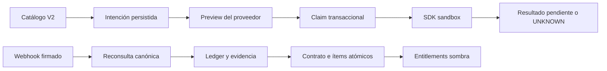

# 13 — Billing V2, proveedores y migraciones reproducibles

Fecha: 22-10-2026, America/Santiago. Iteración 4 en `feature/puragenda-next`.

El catálogo y las estructuras de la iteración 3 se conservan. Ahora existen adaptadores concretos con SDK oficiales, operaciones externas persistentes, conciliación de webhooks firmados y una ruta de migración reproducible. **No se activó billing V2 ni ningún permiso efectivo.** La validación de transporte comercial contra cuentas sandbox sigue pendiente de credenciales y precios V2 aprobados.

## Arquitectura y contratos implementados



Se mantienen separados la cotización local, el preview, la intención, el resultado HTTP, el pago y su aplicación. `CommercialBillingOperation` congela plan/cupos/cotización, contrato anterior, estrategia, fecha, preview, importe esperado e identidad externa. `CommercialPaymentEvidence` registra pago, origen, importe, moneda, período y estado. El evento original queda en `CommercialEvent`, idempotente por proveedor/evento.

El total recurrente local puede ser 22.990 CLP mientras el cargo inmediato del preview sea 1.000 CLP: son conceptos diferentes. El importe de la evidencia debe igualar el importe esperado del preview, y el contrato canónico debe coincidir con el target. La aceptación de una actualización no significa pago.

`contracts.ts` define `SandboxBillingAdapter`: consulta, preview, ejecución, búsqueda de resultado desconocido, verificación, localización y observación canónica. `MercadoPagoSandboxAdapter` usa `PreApproval`, `Invoice`, `Payment` y `User` del SDK instalado. `PaddleSandboxAdapter` usa suscripciones, precios, transacciones, ajustes y `webhooks.unmarshal` del SDK oficial.

Los métodos de ejecución están implementados, pero permanecen condicionados a datos/configuración de prueba. Los transportes de las pruebas se identifican explícitamente como `CONTRACT_FIXTURE`; sus pagos no se presentan como evidencia real de proveedor.

## Operaciones, estados e idempotencia

Estados de operación: PREPARED, SCHEDULED, EXECUTING, UNKNOWN, AWAITING_PAYMENT, PAID, APPLIED, REJECTED y CANCELLED. Un índice parcial permite una sola intención abierta por negocio. Una clave idempotente no puede reutilizarse con otra entrada.

1. Preparar toma el lock de Business y valida contrato, scope y cotización. Un contrato legacy o sin marca de fixture se rechaza.
2. El preview hace lecturas externas fuera del lock; sus importes/moneda e ítems quedan congelados. No hay un preview monetario ficticio de MP.
3. Ejecutar relee contrato e intención bajo lock y persiste EXECUTING **antes** de llamar al proveedor. La red no queda dentro de una transacción.
4. Dos ejecutores concurrentes hacen una única llamada de mutación. También se desactivó el retry automático del SDK MP 3.2 mediante su opción runtime `retries: 0`, comprobada con HTTP 5xx y error de red; no se delega al SDK un segundo intento de creación. Un timeout, o un fallo al persistir después de una aceptación externa, deja UNKNOWN o el claim EXECUTING durable. Ninguno autoriza reintentar el cobro.
5. Resolver UNKNOWN solo consulta. MP busca por referencia propia y exige una coincidencia única. Paddle puede reconciliar una actualización conocida por metadata, pero un alta cuyo ID se perdió sigue UNKNOWN: no se inventa una búsqueda por referencia que el contrato disponible no garantiza.
6. Un webhook válido reconsulta, liga contrato/pago/período/intención y escribe ledger/evidencia. Solo un pago confirmado y suficiente puede aplicar.
7. Aplicar cierra los ítems de base/cupos, crea sus nuevas vigencias y reconstruye el contrato/entitlements dentro del mismo lock. Un conflicto de Staff mantiene PAID sin aplicar hasta resolverse.

Las solicitudes `SeatChangeRequest` existentes pueden vincularse por ID y se validan contra negocio, suscripción, capacidad, importe y fecha. Se conservan la capacidad del negocio y los locks de Staff; no se cambia ningún writer operativo legacy.

Una preparación no ejecutada se puede cancelar localmente. Un checkout ejecutado y abandonado queda pendiente, sin derechos nuevos, y exige conciliar antes de otro alta. Esta iteración no implementa un cron de abandono ni cancelaciones automáticas de acuerdos externos.

## Mercado Pago — Chile

Implementado con SDK oficial:

- `/users/me`: comprobación de cuenta esperada, sitio MLC y etiqueta `test_user` antes de operar;
- `/preapproval` y `/preapproval/{id}`: alta mensual por el importe exacto del catálogo, lectura y actualización; la autorización queda pendiente de evidencia de cobro;
- búsqueda de preapproval por referencia para resolver un resultado perdido, sin creación automática repetida;
- `/authorized_payments`: factura vinculada a la suscripción y al Payment ID;
- `/v1/payments`: estado, importe, moneda, `live_mode=false`, collector, fechas e identidad del pago;
- verificación HMAC mediante el SDK oficial, con tolerancia de timestamp y reconsulta canónica.

La firma autentica el recurso, no concede derechos. Se cruzan referencia de operación, contrato, factura, pago, cuenta, CLP y período. Si falta el fin del período o hay ambigüedad, no se activa la capacidad.

**Prorrateo:** actualizar `auto_recurring.transaction_amount` no demuestra que se cobre una diferencia inmediata. El adaptador bloquea ese cambio durante el ciclo. La documentación de prorrateo de alta respecto de un día fijo no se aplica por suposición a upgrades. [Gestión de suscripciones](https://www.mercadopago.cl/developers/es/docs/subscriptions/subscription-management), [monto proporcional](https://www.mercadopago.cl/developers/es/docs/subscriptions/integration-customization/payment-methods/proportional-amount).

**Renovación:** se conserva la intención local SCHEDULED. El cambio externo al vencer requiere validar el corte real; `COMMERCIAL_V2_MP_RENEWAL_VALIDATED` está ausente por defecto. Se distingue la cuota de su pago final, que puede seguir pendiente o rechazado. [Facturas y pagos](https://www.mercadopago.cl/developers/es/reference/online-payments/subscriptions/overview), [pagos autorizados](https://www.mercadopago.cl/developers/es/docs/subscriptions/integration-configuration/subscription-no-associated-plan/authorized-payments).

Verificado contractualmente: alta exacta, rechazo de cuentas live, autorización sin pago, pago insuficiente/pendiente, factura/referencia equivocadas, duplicados, timeout, error de persistencia, refund/chargeback y bloqueo de prorrateo no validado. **No se verificó transporte MP real:** faltan credenciales separadas y una cuenta de prueba autorizada. No se creó ni modificó una suscripción MP externa.

## Paddle — internacional

Se usan `subscriptions.get`, `previewUpdate`, `update`, `transactions.preview/create/get`, `prices.get`, `adjustments.list({id}).next()` y `webhooks.unmarshal`. La versión instalada no ofrece `adjustments.get`; no se inventó ese método.

El mapa de precios es exclusivamente de servidor. Cada precio se reconsulta y debe estar activo, mensual, en CLP y coincidir con su línea del catálogo. Si falta un precio V2, se registra la dependencia mediante un error explícito. **No se convierten los precios CLP a USD ni se reutilizan precios legacy como equivalentes.**

Actualizar envía la lista completa de ítems: reemplaza los códigos gestionados del catálogo y conserva los demás, junto con la metadata ajena a la operación. No envía un `discount=null` ni elimina un add-on por omisión. Si el target es Plus y quedan complementos no identificados por el catálogo, conserva la lista completa en el preview pero bloquea ejecutar hasta revisar la migración; no presupone que se pueden seguir cobrando junto a la web incluida. Un contrato past_due, paused, trialing o con cambio programado incompatible se bloquea. El payload usa `prevent_change`; un cambio de preview exige volver a revisarlo antes de mutar. [Actualización oficial](https://developer.paddle.com/api-reference/subscriptions/update-subscription/), [preview](https://developer.paddle.com/api-reference/subscriptions/preview-subscription-update/).

El modo inmediato usa el preview del proveedor. `prorated_next_billing_period` difiere el cargo y no se interpreta como prueba de que el contrato también se difirió. NEXT_RENEWAL conserva el trabajo local hasta su fecha; el límite real de renovación sigue bloqueado salvo validación explícita sandbox. [Prorrateo](https://developer.paddle.com/concepts/subscriptions/proration/).

Un transaction.completed canónico debe corresponder al contrato y a la intención, con los ítems correctos, moneda e importe esperados. Ajustes aprobados completos y chargebacks se distinguen de un reembolso parcial, que queda para revisión. No se restaura un derecho por una aprobación tardía del mismo pago ya revertido. [Transacción completada](https://developer.paddle.com/webhooks/transactions/transaction-completed/), [ajustes](https://developer.paddle.com/webhooks/adjustments/adjustment-created/).

**Sandbox real comprobado:** una consulta autenticada mediante MCP Paddle sandbox devolvió tres precios mensuales legacy en USD (Individual, Equipo y profesional adicional). Ninguno es un precio aprobado de Puragenda/Plus V2. Esa consulta verifica acceso de lectura al catálogo conectado; **no verifica el transporte de nuestras clases SDK ni un ciclo comercial V2.** No se usaron suscripciones existentes ni se crearon Prices, transacciones o cobros.

**Pendiente:** credencial privada de SDK y secreto de notificación V2 no están disponibles en el proceso, y faltan precios V2 internacionales aprobados. No se hizo un preview real de suscripción V2 ni un cambio real de prueba. El servidor llamado `paddle-docs` no está disponible: se consultó el buscador de referencia del MCP Paddle sandbox y se corroboró con las páginas oficiales actuales antes de implementar.

## Estrategias durante el ciclo

| Estrategia | Mercado Pago | Paddle | Activación interna |
| --- | --- | --- | --- |
| Próxima renovación | Intención local; actualización externa bloqueada por defecto hasta verificar el corte. | Intención local; ejecución al límite pendiente de validación de renovación. | Fecha efectiva alcanzada y pago conciliado que cubra el nuevo período. |
| Inmediata | Upgrades de contrato bloqueados: el PUT de monto no prueba cobro proporcional. Un cargo independiente sería otra política, todavía no implementada. | Preview + lista completa + modo explícito, con confirmación del pago correspondiente. | Importe liquidado esperado, contrato canónico y período válidos. |
| Cobro diferido | No se inventa soporte de crédito/prorrateo. | El modo de siguiente período no concede derechos porque la actualización haya respondido 2xx. | Espera la evidencia de pago requerida. |

El camino por defecto evita mutaciones antes de resolver la política. Los flags de validación de renovación solo habilitan ensayos sandbox y no sustituyen una decisión de negocio o un corte demostrado. El reloj sintético de las pruebas no se presenta como prueba del calendario real de los proveedores.

## Webhooks, conciliación y seguridad

La ruta nueva es `/api/internal/commercial-sandbox/webhooks/[provider]`. No se tocó ningún webhook legacy. Devuelve 404 por defecto y siempre en un proceso production; necesita base local desechable, flags internos y configuración explícita sandbox. Solo responde 2xx después de completar el procesamiento; un fallo de API/DB devuelve 503 sin payload, secretos ni IDs privados.

Paddle usa unmarshal sobre el body crudo antes de interpretar el evento. MP extrae el ID aún no confiable para verificar el manifiesto con el SDK, valida el timestamp y después consulta factura/pago/contrato. El businessId nunca se toma del body para conceder derechos: se resuelve desde la intención persistida y se contrasta con las referencias canónicas. [Firmas Paddle](https://developer.paddle.com/webhooks/signature-verification/), [notificaciones MP](https://www.mercadopago.cl/developers/es/docs/split-payments/additional-content/your-integrations/notifications/additional-info?scope=prod).

Los modelos nuevos tienen RLS, revocación de grants de PUBLIC/anon/authenticated, claves de tenant, índice de intención abierta y unicidad proveedor/pago. No hay políticas de acceso directo desde navegador. Los importes usan enteros y los estados desconocidos no conceden capacidad.

Separación de entornos:

- variables `COMMERCIAL_V2_*` sin fallback a credenciales legacy;
- entorno obligatorio sandbox, key Paddle con señal sdbx y SDK fijado a Environment.sandbox;
- MP exige token TEST, identidad de cuenta esperada y test_user, además de `live_mode=false` en el pago;
- SDK sin base URL controlada por navegador y referencias acotadas;
- mutaciones externas requieren un opt-in separado y nunca corren en production;
- persistencia comercial limitada a bases de nombre `puragenda_commercial_test` y sufijos efímeros en loopback;
- un contrato debe llevar `sandboxFixture=true` y no tener vínculo legacy;
- `COMMERCIAL_RELEASE_FLAGS` continúa completamente en falso.

## Migraciones históricas y baseline

La cadena original está incompleta: no contiene un CREATE TABLE Client, pero `20260505_add_marketing_campaigns` ya intenta alterarla. Reordenar una sola migración no reconstruye de forma fiable ese historial. Se conservan **todos** los archivos históricos y sus registros existentes.

`prisma/bootstrap/` contiene un baseline congelado del esquema del commit `e471373`, SQL para objetos no representados por Prisma y un manifiesto con origen/hashes históricos. Se reconstruyeron 56 checks, 76 tablas con RLS documentado, tres índices parciales y el trigger de capacidad de reservas. Los objetos de una migración de AppointmentReview, ausentes en ese esquema, se enumeran como incompatibilidad: no se crean funciones no integradas ni se eliminan datos en una base que los tenga.

El procedimiento usa Prisma 7.10 instalado y el mecanismo soportado de [baselining de Prisma v7](https://www.prisma.io/docs/orm/v7/prisma-migrate/workflows/baselining). Los SQL forward siguen viviendo **una vez** en `prisma/migrations/`; el runner monta un directorio temporal con el baseline y las migraciones desde `20261021120000` en adelante.

**Instalación vacía:** `npm run db:commercial:bootstrap` exige que no haya tablas de aplicación y ejecuta `prisma migrate deploy` sobre ese historial. No hay db push ni marcado ficticio del historial.

**Legacy representativo:** `npm run db:commercial:legacy` verifica primero diff estructural vacío respecto del baseline, checks validados, RLS, índices y trigger. Solo si ya existen los efectos completos registra el baseline mediante `migrate resolve --applied`; luego despliega las migraciones forward. Rechaza deriva o migraciones fallidas. Nunca elimina o modifica filas históricas de `_prisma_migrations`.

El ensayo legacy contiene un registro histórico cuyo efecto de FK existe y se verifica antes de registrarlo. La actualización conserva ese registro byte a byte y todos los datos de Business, Subscription y WebsiteAddon. La segunda ejecución conserva filas e historial. La ruta original de migrations continúa archivada en su ubicación; los entornos adoptados deben continuar usando el runner y no intentar replay del historial antiguo sobre el baseline.

Estos comandos están restringidos a bases locales de prueba. **No son autorización para adoptar el baseline en producción.** Una base desplegada con otras tablas, políticas o deriva necesita inventario autorizado y una reconciliación explícita; el script se detiene. No se ha ensayado una copia productiva.

## Reproducción

Con PostgreSQL local y un rol que pueda crear bases desechables:

```powershell
$env:COMMERCIAL_V2_TEST_DATABASE_URL='postgresql://USUARIO_LOCAL@127.0.0.1:55443/puragenda_commercial_test'
npm run test:commercial:migrations
npm run test:commercial:postgres
node scripts/test-commercial-postgres.mjs --all
npm run build:commercial:isolated
```

El runner de pruebas crea una base efímera nueva por ejecución. No borra schemas ni historiales existentes. Las bases de ensayo se conservan para inspección local. Bootstrap/legacy no aceptan destinos remotos y son repetibles. El build usa un proceso production sanitizado, base loopback, sin credenciales de proveedor, escritores cerrados y `.next-websites-build`; rechaza archivos `.env` ambientales.

## Compatibilidad y decisiones antes del lanzamiento

INDIVIDUAL/EQUIPO/TEST, descuentos, free months, promociones, referidos, trials, anualidad, transferencia, founder y add-on web continúan en los flujos legacy. El motor V2 no los migra ni reemplaza sus IDs. El snapshot conserva términos y el adapter Paddle no elimina add-ons; una transición a Plus con add-on web requiere resolver su migración y queda bloqueada para evitar doble cobro. El downgrade no borra BusinessWebsite ni sus assets.

Decisiones pendientes y efecto técnico:

- IVA neto/bruto: determina la correspondencia entre precio local, tax_mode y grand_total del proveedor. El sandbox no constituye una aprobación tributaria.
- Internacional: requiere catálogo/moneda y Price IDs aprobados; no hay conversión automática desde CLP.
- Prorrateo: define importe esperado, momento de cargo y período que autoriza capacidad. Se conservan ambos conceptos monetarios por separado.
- Anualidad V2: sigue rechazada; no se toca la anualidad legacy.
- Trials V2: no se conceden nuevos trials por suposición; legacy se preserva.
- Renovación: necesita comprobar las carreras con el cobro automático antes de habilitar cualquier ejecución real al límite.

Antes de una activación futura: completar credenciales/precios sandbox, probar transporte, firmas, previews y ciclos reales; cerrar decisiones monetarias; ensayar una copia legacy autorizada; implementar autorización/contratación y migración voluntaria; resolver web incluida sin doble cobro; mantener observación sombra y preparar el único lanzamiento público. No se implementó la UX de contratación, envío comercial, Contact Flow ni Puri+.

Resultados exactos, archivos y commits: [14 — Validación de iteración 4](./14-iteracion-4-validacion.md).
