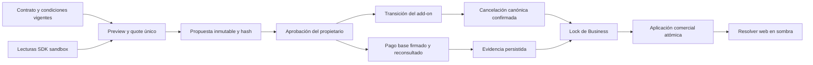

# 15 — Web incluida en Plus y migración comercial voluntaria

Fecha: 22-10-2026, America/Santiago. Base: `7f271bf`, rama `feature/puragenda-next`.

Esta iteración implementa un resolver web de servidor, propuestas persistentes inmutables, aprobación explícita y conciliación de transiciones. Son funcionalidades internas comprobadas con Prisma y PostgreSQL real. No existe cutover público, nuevo checkout ni ejecutor de cancelaciones. La evidencia económica de los ensayos es `CONTRACT_FIXTURE`, no un cobro de proveedor.

## Arquitectura implementada

- `src/server/websites/commercial-access.ts`: política central de editor, preview, publicación, hosting, dominios, medios y compra independiente.
- `src/server/commercial-migration/preview.ts`: inventario, fingerprint estable, catálogo, beneficios, bloqueos y preview de proveedor de solo lectura.
- `service.ts`: preparación, aprobación, estados, evidencias y aplicación bajo lock PostgreSQL.
- `owned.ts`: fachada para la futura interfaz Mi Plan, autenticada por sesión y limitada al propietario.
- `CommercialMigrationProposal`, `CommercialWebsiteTransition` y `CommercialMigrationEvidence`: almacenamiento privado con RLS y claves de tenant.

Se reutilizan BusinessWebsite, WebsiteAddon, WebsiteCheckoutOperation, WebsiteOfferEligibility, CommercialSubscription, CommercialEntitlement, CommercialEvent y los adaptadores de la iteración 4. WebsiteBillingEvent y los webhooks legacy mantienen su comportamiento; no se cambia su significado ni se inventan eventos de cancelación.

## Fuentes del derecho web

| Caso | Resultado en la política sombra |
| --- | --- |
| Puragenda mensual efectivo | Link y widget; sin editor, hosting ni compra separada del módulo web V2. |
| Plus efectivo y pagado | Editor, preview, publicación, hosting, dominios y medios incluidos, sin WebsiteAddon. |
| Plus pendiente, UNKNOWN o sin evidencia | No concede Plus. Un derecho legacy todavía válido puede continuar por su propia fuente. |
| Legacy con add-on activo y vigente | Conserva el derecho usando la política legacy existente y el acceso operativo del plan base. |
| Founder con trial válido | Usa la elegibilidad sellada y las fechas originales; no recalcula el beneficio. |
| Gracia vigente | Respeta las reglas del plan base y los límites de vigencia; gracia vencida no concede acceso. |
| Cancelado, suspendido o período vencido | No obtiene web incluida. El contenido permanece guardado. |
| Plus con downgrade aprobado futuro | Mantiene Plus hasta aplicar el nuevo período pagado. |

Una etiqueta ACTIVE o una fila de entitlement aislada no basta: Plus necesita período efectivo, `lastPaymentStatus=CONFIRMED`, evidencia y fecha de pago. Los trials V2 nuevos siguen sin habilitarse por suposición. La compra externa del dominio no está incluida.

Los permisos de usuario siguen separados del plan: `website.manage`, pertenencia activa al negocio y ámbito de sucursal. Plus no convierte a un empleado en administrador. La fachada financiera exige propietario, incluso si otro rol tiene acceso al editor.

`assertStandaloneWebsiteCheckoutShadow` impide preparar una segunda contratación web para Plus y exige upgrade para el nuevo Puragenda estándar. Es una frontera de servidor preparada para el futuro checkout, no un botón oculto. El checkout público actual no la importa todavía.

## Preparación para el cutover

`selectWebsiteGateShadow` conserva por defecto el resultado legacy. El opt-in `COMMERCIAL_V2_WEBSITE_GATES=1` solo acepta una base local de pruebas y nunca un proceso production. Los gates actuales de panel, acciones, publicación, medios y dominios **no se sustituyeron** en esta entrega.

La integración futura deberá llevar cada gate al mismo resolver y combinarlo con su autorización actual. La existencia del resolver no certifica que ese cutover ya esté realizado. Todos los flags públicos de CommercialRelease continúan falsos.

## Propuestas, precios y aprobación

El preview lee el contrato legacy, snapshot comercial, cupos, Staff activos, condiciones económicas, premios/referidos, add-on, operaciones web abiertas, oferta founder y existencia de sitio/dominios. Las listas se ordenan antes de calcular el fingerprint; su orden incidental en PostgreSQL no invalida una propuesta.

La respuesta contiene plan actual/solicitado, profesionales contratados/activos/solicitados, quote y tramos marginales del catálogo, funcionalidades retenidas/agregadas/perdidas, beneficios, add-on, próximo cobro, fecha efectiva, preview del proveedor y bloqueos.

El precio contractual legacy no reconciliado queda `null`. La tarifa nominal de referencia es otro campo y no se presenta como cargo definitivo. Los importes internacionales desconocidos tampoco se sustituyen por una conversión desde CLP. El cargo esperado y el precio mensual del proveedor se mantienen separados.

Preparar no aprueba, cobra ni concede derechos. La propuesta congela payload, fingerprint de origen, hash del preview, catálogo, cantidad y fecha. Un trigger PostgreSQL impide editar esos campos y la identidad de una aprobación ya registrada.

La aprobación exige sesión/propietario, confirmación explícita y hash exacto. Reconsulta el contrato y preview del proveedor, toma el lock de Business y vuelve a comprobar el estado local. Una propuesta caducada, un cambio de precio, contrato, cantidad, pago, proveedor o condiciones la invalida. La vigencia del preview para aceptar es de 30 minutos; una aprobación válida puede esperar la renovación acordada.

Por defecto las propuestas permanecen BLOCKED por IVA/política de renovación/validación real de migración. Las únicas aprobaciones completas ejecutadas aquí utilizan dependencias contractuales y `COMMERCIAL_V2_MIGRATION_FIXTURES=1` en base desechable. Ese opt-in no se acepta desde la fachada de cliente ni habilita producción.

Descuentos, meses gratis, precio personalizado, premios, promociones, referidos con condiciones, transferencia, anualidad, Test, trial, past_due y cancelación tienen bloqueos explícitos de revisión. Se preservan los datos; no se implementa una equivalencia económica que consuma o borre esos beneficios. Guardar un snapshot no significa haber resuelto su migración financiera.

## Estados persistentes

| Estado de propuesta | Significado |
| --- | --- |
| AWAITING_APPROVAL | Preview confirmable en el ensayo autorizado; no hay aceptación. |
| BLOCKED | Faltan decisiones o evidencia suficiente. |
| PENDING_PROVIDER_CHANGE | Propietario aprobó; no implica modificación externa. |
| PENDING_RECONCILIATION | Espera pago y/o fin efectivo de facturación del add-on. |
| SCHEDULED | Evidencia válida para una fecha/período futuro. |
| UNKNOWN | No se pudo determinar canónicamente el resultado del add-on. |
| APPLIED | Nuevo contrato aplicado una sola vez, dentro de la transacción comercial. |
| INVALIDATED | El origen o preview cambió; se necesita una nueva propuesta. |

El add-on tiene su propia transición: REVIEW_REQUIRED, PENDING_CANCELLATION, SCHEDULED, UNKNOWN, CANCELLED_VERIFIED e INCLUDED; sin add-on usa NOT_REQUIRED. Estos estados no sobrescriben WebsiteAddon ni afirman que el proveedor canceló algo porque la aplicación lo haya solicitado.

## Prevención del doble cobro

1. Detectar todas las operaciones de checkout abiertas, incluidas UNKNOWN; no se omiten por antigüedad.
2. Conservar referencia, proveedor, precio founder como referencia histórica y fin del período pagado.
3. Prohibir una fecha efectiva anterior al período pagado del add-on o a su cancelación programada conocida.
4. Tras aprobación, consultar canónicamente el contrato del add-on. Timeout deja UNKNOWN; repetir solo hace GET.
5. Un `scheduled_change` de Paddle no es una cancelación efectiva. Solo estado terminal canónico permite CANCELLED_VERIFIED. [Cancelación Paddle](https://developer.paddle.com/api-reference/subscriptions/cancel-subscription/).
6. `canPrepareBaseProviderChange` permanece falso mientras el add-on no esté confirmado o no llegue la fecha. No hay ejecutor externo en esta iteración.
7. Conciliar el pago base con firma, reconsulta, referencia de propuesta/contrato, moneda, importe esperado y período. Un pago ajeno o antiguo no sirve.
8. Aplicar únicamente cuando pago, fecha, contrato y cancelación estén conciliados. Si llega un pago mientras el add-on sigue facturando, conservar evidencia y bloquear aplicación; no emitir otro cobro.

El ensayo Individual 12.990 + web nominal 9.990 → Plus 22.990 usa el quote aprobado, no suma dos nuevas suscripciones. Founder conserva su oferta 5.990 como referencia original; no se vuelve a calcular elegibilidad ni se cambia la fila histórica. Los precios no reconciliados se muestran desconocidos.

No se ejecutaron cancelaciones ni llamadas de escritura a proveedores. No hay promesa de atomicidad distribuida entre dos proveedores: antes de habilitar un ejecutor deberán demostrarse el corte real, recuperación de fallos parciales y ausencia de solapamiento. El sistema no marca una cancelación externa desde un booleano de navegador.

## Pago, vigencias y aplicación

La conciliación reutiliza HMAC Mercado Pago o `paddle.webhooks.unmarshal()` y las lecturas canónicas de los adaptadores existentes. La evidencia almacena origen, ID de evento/pago, importe, moneda, contrato y período. Se comprueba también que el pago no pertenezca a una operación de billing V2 anterior.

El lock de Business serializa aprobación/aplicación, cambios de cupos y preparación de billing. Un índice parcial permite una sola migración abierta aprobada por negocio. Las claves idempotentes y de eventos/pago impiden doble aplicación. Un fallo de persistencia revierte evidencia, ítems y snapshot juntos; no se repite una mutación externa.

La aplicación cierra las vigencias de ítems base/cupos, crea los ítems del quote único y reconstruye entitlements en sombra. Al incluir la web cierra el ítem legacy correspondiente y registra INCLUDED, conservando el contrato original y sus beneficios como evidencia histórica. WebsiteAddon conserva sus campos reales; su retiro comercial se resuelve desde la transición.

Un reembolso, contracargo o cancelación canónica del contrato aplicado revoca solo su proyección autorizada; una aprobación antigua no la restaura. La vigencia de web Plus depende del período del nuevo plan, no del antiguo vencimiento del add-on.

## Downgrade, contenido y dominios

El downgrade se prepara para renovación. Antes de la fecha conserva el derecho Plus pagado; después de conciliar el nuevo período estándar cesan las capacidades exclusivas si no existe otra fuente válida.

No se actualiza ni elimina BusinessWebsite, borradores, versión publicada, templateConfigs, subdominio, WebsiteDomain, WebsiteMedia, ofertas ni assets Cloudinary. Tampoco se desconectan dominios o se llama a proveedores DNS/hosting. El estado de publicación almacenado se conserva para una recuperación posterior.

`resolveWebsiteHostShadow` busca el subdominio exacto o un dominio ACTIVE con verificación de tenant. Cuando no hay derecho devuelve SUSPENDED sin sitio ni configuración privada. No sirve la página de otro negocio. El link y widget de reservas siguen dependiendo del plan operativo, no de comprar web.

## Aislamiento y validación

- Escritores requieren loopback, nombre de base `puragenda_commercial_test` con sufijo opcional, flags internos y `COMMERCIAL_V2_MIGRATION_WRITES=1`.
- Production se rechaza aunque existan flags. No hay rutas nuevas abiertas ni Server Actions públicas.
- La fachada deriva businessId/actor de sesión, rechaza propiedades adicionales y no recibe precios, políticas, provider proof o estados arbitrarios.
- RLS habilitado y grants PUBLIC/anon/authenticated revocados en las tres tablas nuevas. Claves compuestas impiden referencias entre negocios. [RLS Supabase](https://supabase.com/docs/guides/database/postgres/row-level-security).
- No se registran payloads, credenciales, emails, contenido web o notas comerciales en logs nuevos.
- La migración es aditiva y se despliega por el runner de baseline de iteración 4; no se modifica el historial antiguo.

Reproducción: los mismos comandos del documento 13. `test:commercial:postgres` incluye ahora las tres suites comerciales (79 tests). La suite completa incorpora los 31 tests unitarios nuevos y las pruebas legacy de webs, checkout, permisos, dominios y widgets.

El servidor `paddle-docs` no está disponible. Se consultó el buscador de documentación del MCP Paddle sandbox para `subscriptions.get/cancel` y se conservaron los adaptadores SDK oficiales; ninguna operación de cuenta fue ejecutada. No se comprobó un ciclo V2 real de MP/Paddle ni DNS de clientes.

## Pendientes y próxima fase

Siguen pendientes credenciales/precios V2 sandbox, IVA/fiscalidad, anualidad y trials nuevos, política final de prorrateo/renovación, equivalencia de beneficios especiales, ejecutor coordinado de transición y UX Mi Plan. El cutover de todos los gates web y billing debe validarse antes del único lanzamiento público. Los fixtures no resuelven esas dependencias.

Para Puri+: reutilizar entitlements/roles/sucursales, calcular señales deterministas y guardar recomendaciones con evidencia/versión/expiración. Separar propuesta y aprobación del futuro Contact Flow; no añadir tools de cobro o envío autónomo. Presupuesto, consentimiento, cuotas y ejecución durable pertenecen a sus fases posteriores.

Resultados exactos y commits: [16 — Validación de iteración 5](./16-iteracion-5-validacion.md).
