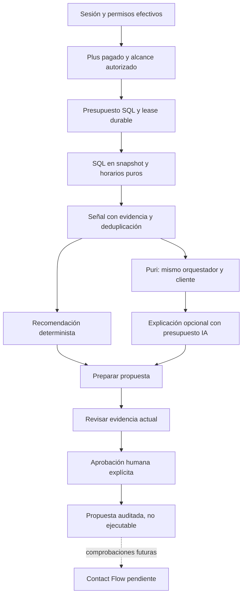
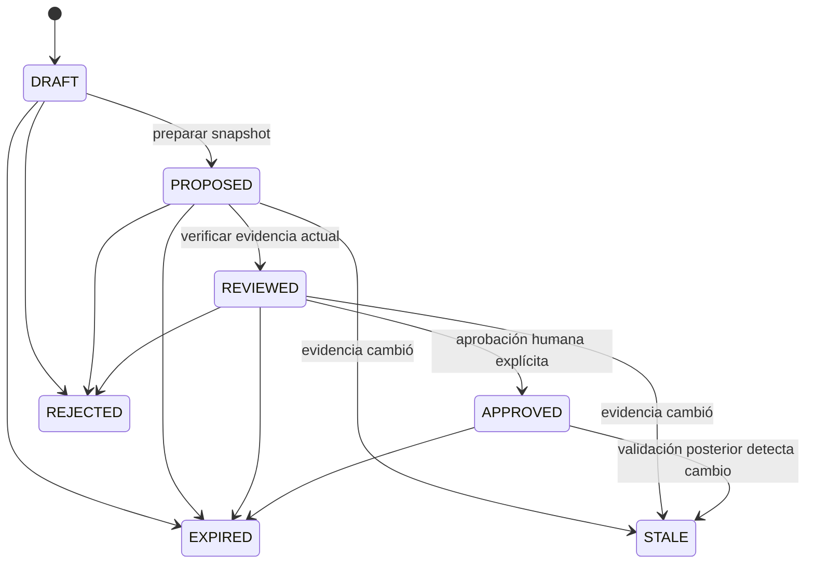

# Iteración 6 — Puri+ e inteligencia comercial

**Continuidad de iteración 7:** el contrato de propuestas de este documento se conserva. Contact Flow agrega campañas, consentimiento, autorización de ejecución, outbox y atribución en laboratorio; ver [19](./19-contact-flow-ejecucion.md) y [20](./20-iteracion-7-validacion.md). La aprobación de la propuesta sigue sin ser permiso de envío.

Fecha: 22-10-2026. Estado: implementación interna en PostgreSQL desechable, sin activación productiva. «Tu agenda se organiza. Tu negocio crece.»

## Arquitectura implementada

Puri sigue teniendo un solo orquestador (`src/server/puri/orchestrator.ts`), cliente OpenAI, modelo configurado, Responses API, formato de respuesta y bucle de herramientas. La extensión opcional de capacidades se construye exclusivamente en servidor. La ruta habitual `/api/dashboard/puri`, sus herramientas operativas, contexto, prompt y componente no se sustituyen. Los presupuestos de estándar están preparados como categoría, pero no se conectaron al flujo productivo existente.



Los módulos nuevos están en `src/server/puri/growth/`: `access`, `contracts`, `evidence`, `occupancy`, `analysis`, `budgets`, `recommendations`, `input-policy`, `tools`, `runtime`, `proactive`, `retention` y `monitoring`. No importan ejecutores de marketing, Resend, cambios de suscripción ni mutaciones de disponibilidad.

## Acceso, niveles y aislamiento

| Nivel | Comportamiento |
|---|---|
| `PURI_STANDARD` | Puri operativo existente; default de telemetría para registros antiguos y nuevos estándar |
| `PURI_PLUS` | Lectura de agregados comerciales autorizados |
| `PURI_PLUS_PREPARE` | Capacidad adicional para preparar propuestas; no autoriza aprobación ni ejecución |

`assertGrowthSandbox` exige simultáneamente `COMMERCIAL_V2_INTERNAL_WRITES=1`, `PURI_PLUS_INTERNAL_ENABLED=1`, host PostgreSQL loopback y nombre `puragenda_commercial_test[_sufijo]`. Rechaza `NODE_ENV=production`, incluso con flags abiertos. No existe un interruptor para habilitar esta implementación en producción.

`createGrowthScope` y `revalidateGrowthScope` vuelven a consultar usuario, membresía activa, propietario, permisos y suscripción. No confían en roles enviados por el navegador ni en un objeto de alcance alterado. El scope incluye negocio, sucursal, agenda propia y máscaras de permisos, y se compara íntegramente al revalidarlo.

Se exige plan `PURAGENDA_PLUS`, estado comercial efectivo, período aplicable y evidencia persistida de último pago confirmado con fecha e identificador. Se admiten `ACTIVE`, `SCHEDULED_CHANGE` y gracia vigente, evaluados por el motor comercial existente. Trial V2 y pago pendiente no habilitan esta fase: la política comercial de trial sigue pendiente.

La propiedad no se deduce del rol `ADMIN`: se verifica `Business.ownerId`. Un no propietario necesita `Staff` activo y asignación activa a la sucursal. La vista global de sucursales del servicio se reserva al propietario. El laboratorio permite elegir entre sucursales autorizadas. Los registros legacy sin sucursal pertenecen a la primaria en la consulta de sucursal.

Antes de las consultas analíticas:

- agenda: `appointments.view_all` o agenda propia con `appointments.view_own`;
- finanzas: analítica del negocio o analítica propia dentro de una agenda propia;
- cohortes y retención: `clients.manage`;
- preparación/revisión/aprobación/rechazo: propietario o `marketing.manage` efectivo;
- detalle de presupuesto del negocio: propietario o analítica del negocio sin restricción a agenda propia;
- monitoreo de plataforma: sesión Superadmin existente y comprobación actual de `isSuperAdmin`.

Los datos de distintas máscaras de permisos no comparten caché ni recomendaciones. Los FKs compuestos impiden enlazar una señal, recomendación o auditoría con otro negocio/alcance. Las siete tablas nuevas tienen RLS y ningún grant a `PUBLIC`, `anon` o `authenticated`. El servidor privilegiado aplica además el scoping; RLS no pretende autorizar por sí sola sus consultas como propietario de tablas.

## Ventanas, SQL y evidencia

Se comparan 7, 14 o 28 días civiles completos, excluyendo el día parcial actual, contra el período inmediatamente anterior de igual duración. La conversión usa el timezone efectivo y las utilidades existentes para días locales/DST. El historial de cadencia es de 365 días. La cohorte sí considera visitas completadas hoy hasta el análisis, para no marcar como inactivo a quien acaba de volver.

`collectGrowthEvidence` usa `Prisma.sql` parametrizado y un snapshot `RepeatableRead`, timeout SQL por sentencia de 8 s y timeout transaccional de 20 s. Límites: 20.000 reservas del horizonte consultado, 30 profesionales, 10 sucursales y 2.000 bloqueos. Las excepciones se consultan únicamente en la ventana. Horarios, miembros, bloqueos e intervalos tienen orden explícito para obtener hashes reproducibles. Si se excede un límite se rechaza el análisis; no se entrega una muestra como si fuera el total.

| Consulta | Datos obtenidos | Distinción relevante |
|---|---|---|
| Conteos con `FILTER` | Reservas actuales/anteriores, cancelaciones y próximas reservas | La demanda/ocupación excluyen canceladas, no-show y retenciones pendientes de pago |
| Visitas distintas por cliente y día, `lag`, `percentile_cont(.5)` | Frecuencia y cohorte preliminar inactiva | Duplicar visitas del mismo día no reduce artificialmente la mediana |
| `NOT EXISTS` de próximas citas | Exclusión de clientes con reserva futura | Se comprueba dentro del negocio incluso si la próxima cita está en otra sucursal; no se devuelve esa cita |
| Agrupación por servicio | Conteos actuales/anteriores y desempeño | Ranking acotado a 30 servicios por demanda actual; no se afirma cubrir todo un catálogo mayor |
| Cohortes de visitas completadas | Clientes nuevos en el alcance, recurrentes y retorno entre períodos | Primera visita se comprueba con el historial disponible completo; no es atribución de marketing |
| CTE de recibos y `GROUPING SETS` | Cobros registrados y nominal por servicio/total | Evita multiplicar pagos mediante joins con reservas |
| Horarios y unión de intervalos | Minutos disponibles/ocupados, días, horas y agendas | No usa las 24 horas del día como denominador |

No se seleccionan nombre, email, teléfono, notas privadas ni `acceptsMarketing` de clientes para estas consultas. Los identificadores usados para joins, deduplicación y fingerprints no se transforman en listas de destinatarios. Las etiquetas de servicios y profesionales son anónimas en evidencia/modelo.

Cada análisis conserva período, reglas, versión `growth-v1`, hash SHA-256 de evidencia agregada y fingerprint de las fuentes relevantes. Los fingerprints SQL ordenados incluyen identidad de filas, estados y tiempos; la cohorte tiene un hash separado de sus miembros y umbrales. Esto detecta cambios aunque un conteo siga igual. El modelo no calcula estos indicadores.

### Inactividad

La visita elegible es completada. Se usa el doble de la mediana personal si hay al menos tres intervalos entre días de visita. En otro caso se usa el doble de la mediana del negocio si hay al menos ocho intervalos y cinco clientes; si no, un fallback configurable de 45 días. El umbral se acota entre 14 y 180 días. Se excluyen próximas reservas pendientes/confirmadas/en atención, incluyendo retenciones de pago.

La señal exige al menos cinco clientes. El fallback tiene confianza baja. `thresholdDays` es el menor umbral de la cohorte, **no** una regla uniforme para todos los destinatarios. La propuesta conserva las reglas originales y la versión de política para recalcularlos. Los contactos comercialmente elegibles siguen siendo desconocidos hasta verificar consentimiento y supresiones en Contact Flow.

### Ocupación

Reutiliza `buildSlots` y `slotToUtc` puros; no llama a `getBlockedSlots`, porque ese servicio libera retenciones vencidas y puede consultar Google. Se respetan horarios operativos legacy, horarios por sucursal, agenda del profesional o membresía, descansos, overrides, días bloqueados, bloqueos manuales y prioridad liberada. Individual utiliza una agenda física y los bloqueos de profesionales del negocio; Equipo utiliza agendas por profesional.

Los intervalos disponibles se unen por profesional. Las reservas superpuestas se unen antes de medir minutos. Una sesión recurrente cuenta por su `Appointment`; no se vuelve a sumar `RecurringBooking`. Un profesional en dos sucursales no duplica capacidad en la vista global. Las franjas y días agregados se expresan en el timezone de análisis, indicado en evidencia.

La ocupación queda desconocida y no produce señal accionable si faltan horarios, hay overrides incompletos, calendario externo sin conciliación, capacidad ambigua de un profesional compartido por sucursal, reservas sin asignación o alcance propio con disponibilidad compartida no comprobada. No se consultan tokens ni free/busy externos. El historial de horarios no está versionado: incluso una capacidad completa significa **horarios actuales con excepciones almacenadas**, con confianza limitada; no certifica un horario histórico reconstruido.

### Cobros, nominal y desconocidos

Se consideran únicamente registros autorizados de citas del período; no se presenta un flujo bancario por fecha de pago. Se suman abonos aprobados, POS aprobados en la moneda del negocio y Gift Cards registradas, con tope del importe de la cita. Un cierre manual con total histórico conocido reconoce ese total. Canceladas, no-show y retenciones pendientes no se computan como ingreso de esta consulta.

Un precio actual de servicio puede estimar el nominal cuando falta `Appointment.totalPrice`, pero **no** prueba cuánto se cobró históricamente. Si existe pago/cierre sin ese total histórico, `collected=null`; se devuelve `knownCollected` separado y cantidad de citas con cobro desconocido. `estimatedNominalAppointments` identifica el nominal estimado. Lo desconocido nunca se transforma en ingreso cero. La explicación determinista y las herramientas conservan estas distinciones.

### Señales y prioridad

| Tipo | Disparador por defecto | Prioridad/confianza |
|---|---|---|
| `INACTIVE_CLIENTS` | Cohorte preliminar ≥5, sin próxima cita | `min(90, 50+n)`; baja con fallback, media con cadencia |
| `LOW_OCCUPANCY` | Capacidad completa ≥300 min y ocupación <35% | `round(85-ocupación)`; media por limitación histórica |
| `DEMAND_DECLINE` | Período anterior ≥10 reservas y caída ≥20% | `min(95, round(50+caída/2))`; alta con muestra anterior ≥30, si no media |
| `SERVICE_TREND` | Servicio con muestra anterior ≥10 y variación absoluta ≥20% | 55; media; servicios dentro del ranking acotado |

Son reglas deterministas, no un score de rentabilidad validado. La actualidad se controla con ventana/expiry y la accionabilidad con permisos/completitud/consentimiento pendiente. No existe un cálculo de ROI o ingresos garantizados.

## Persistencia y proactividad

La migración aditiva `20261022210000_puri_plus_growth` añade:

| Modelo | Responsabilidad |
|---|---|
| `PuriGrowthPolicy` | Reglas y frecuencia local por negocio; proactividad desactivada por defecto |
| `PuriGrowthRun` | Scope, ventana, lease/token, intentos, evidencia, duración, caché y revisión proactiva |
| `PuriGrowthSignal` | Tipo, hash, prioridad, confianza, deduplicación, supresión y expiry |
| `PuriGrowthRecommendation` | Snapshot, propuesta/versiones, explicación, consumo y aprobación humana |
| `PuriBudgetBucket` | Límites/compromisos mensuales globales, de negocio y categoría |
| `PuriUsageReservation` | Idempotencia, reserva, liquidación/estado desconocido y tokens informados |
| `PuriGrowthAudit` | Creación, preparación, vista, decisiones y alertas sin textos personales |

`PuriRequest.capabilityTier` diferencia estándar/Plus sin almacenar conversaciones. Se añaden checks de estados, no ejecución, importes, aprobación y estrategia, índices por tenant/estado/lease/expiry y trigger de inmutabilidad de propuesta/evidencia/aprobación. El despliegue canónico comprueba RLS y ausencia de grants nuevos, además de preservar la seguridad legacy.

`analyzeGrowth` usa una clave por negocio/scope/reglas/ventana/hora. Un lock transaccional corto concede el lease de 60 s; el SQL corre fuera de ese lock y el resultado se persiste sólo si conserva el token. Un análisis completo se reutiliza durante su hora; una ejecución concurrente informa que está en proceso. Se permiten tres intentos de recuperación ordinaria, siempre con presupuesto SQL. Un fallo no confirma señales parciales.

Las señales se deduplican por tipo/evidencia/versiones y se suprimen por material relevante durante siete días. Para inactividad, el material incluye la cohorte y sus umbrales, no cualquier cambio de cobros del negocio. Rechazar suprime esa evidencia. El expiry inicial es de siete días; los estados expirados no son aprobables.

`runGrowthScheduler` es un servicio invocable, **sin cron ni ruta productiva**. Exige también `PURI_PLUS_PROACTIVE_ENABLED=1` y políticas opt-in locales. Recorre negocios/sucursales con cursor, máximo diez candidatos por lote, máximo diez sucursales por negocio, presupuesto global/categoría y deadline entre trabajos. Cada SQL sigue teniendo su timeout propio; un trabajo ya empezado puede finalizar después del deadline del lote. Frecuencia configurable entre 1 y 168 horas, default 24. La marca durable de revisión proactiva también se actualiza si reutiliza un análisis interactivo.

No genera recomendaciones IA en lote. Un cursor permite continuar un lote parcial. Un lease vencido se recupera sin confirmar el resultado del trabajador anterior. Las reservas abandonadas por más de dos minutos se liquidan en lotes de hasta 25: SQL consume su unidad; IA conserva el compromiso como desconocido, sin repetir la llamada.

## Herramientas del mismo Puri

`GROWTH_TOOL_POLICY` declara permisos, nivel, modalidad, presupuesto y datos devueltos. Todas reciben objetos estrictos sin IDs de negocio/sucursal arbitrarios. El scope viene de servidor.

| Herramienta | Permiso adicional | Resultado/consumo |
|---|---|---|
| `get_growth_signals` | Agenda autorizada + Plus | Señales, tendencias, capacidad y retención permitida; SQL cacheado |
| `get_service_performance` | Analítica del alcance | Reservas, cobro conocido/desconocido y nominal; SQL cacheado |
| `get_inactive_client_cohort` | Clientes | Conteo, reglas, cadencia y consentimiento sin verificar; no destinatarios |
| `get_growth_recommendations` | Agenda autorizada | Snapshots del mismo scope; lectura acotada |
| `prepare_contact_flow` | Propietario/marketing y petición explícita de preparación | ID/hash/versión de propuesta; no ejecución ni aprobación |

No se duplican herramientas separadas para cada dimensión que ya devuelve `get_growth_signals`. Las herramientas operativas con datos personales no se exponen en el turno comercial agregado. Una llamada inventada, una herramienta estándar invocada mediante injection o una aprobación conversacional se rechaza antes del ejecutor.

La pregunta libre se reduce en servidor a un vocabulario cerrado de intención y métricas; el modelo recibe esa representación y agregados, **no el texto original**, nombres incidentales ni detalles clínicos que alguien escriba. La preparación sólo se expone cuando existe intención explícita y permiso; una explicación de recomendación es de lectura. Este laboratorio no interpreta períodos arbitrarios ni entidades personales desde lenguaje natural: usa reglas/ventana configuradas y las muestra.

Se conserva `store:false`, esquema estricto de respuesta, herramientas sin ejecución paralela y el máximo existente de cuatro rondas. La extensión valida JSON de Plus y rechaza respuestas sin evidencia verificada. Fallbacks deterministas responden a ocupación, cohortes, servicios, retención y cobros; no dependen del modelo.

La implementación sigue el contrato vigente de [function calling](https://developers.openai.com/api/docs/guides/function-calling) y [salidas estructuradas](https://developers.openai.com/api/docs/guides/structured-outputs?api-mode=responses), consultados para esta iteración. RLS privada sigue la guía de [Supabase](https://supabase.com/docs/guides/database/postgres/row-level-security). No se fijó ni inventó una tarifa de modelo.

## Recomendaciones, revisión y contrato Contact Flow



El borrador determinista tiene cifras y criterios reales. La IA puede mejorar la explicación de un borrador mediante el mismo orquestador, con modelo/tokens/costo persistidos; no reescribe propuestas ya preparadas. Preparar añade estrategia y aumenta la versión; congela el contenido con SHA-256. Reintentos de la misma preparación retornan el snapshot existente.

Revisión y aprobación consultan de nuevo evidencia mediante SQL presupuestado, sin confiar en la caché. Se exige negocio/scope, hash y versión exactos, expiry válido y transición legal. El contenido preparado y la identidad/fecha/hash de aprobación son inmutables en PostgreSQL. El lock/CAS evita dobles aprobaciones. `VIEWED` es único por usuario y recomendación; no pretende contar cada apertura.

La comprobación de evidencia es puntual: no bloquea la agenda mientras el propietario piensa ni congela todas las escrituras operativas. El cambio de ventana al siguiente día también invalida el snapshot al verificarlo. Antes de una futura ejecución deben revalidarse datos y condiciones; una aprobación previa nunca convierte la consulta en una reserva de destinatarios.

La estrategia conserva objetivo, reglas de cohorte/cadencia, 365 días de historial, duración de 14 días, frecuencia gradual diaria, límites sugeridos de 5/día y 50/mes, cinco exclusiones únicas, consentimiento fresco obligatorio, plantilla pendiente de revisión, audiencia preliminar, riesgos y aprobación requerida. Son **valores de propuesta local**, no cuotas comerciales aprobadas. El límite de esquema para esta prueba es 10/día y 100/mes. La caducidad está vinculada al snapshot y señal de siete días.

`approvedGrowthHandoff` sólo entrega un contrato tras validar autorización, versión, estado, expiry y evidencia. Devuelve IDs/scope, aprobación, reglas y `executable:false`. No crea outbox, campaña, enrollment, mensaje, descuento ni cambio de suscripción. No llama a marketing manual.

Contact Flow deberá volver a comprobar entitlement efectivo, autorización, consentimiento individual verificable por finalidad, supresiones/bajas, próximas reservas/contactos recientes, cuotas diarias/mensuales/globales, presupuesto, hash/versión, configuración del motor, política legal y estado de suscripción. Después deberá implementar idempotencia de ejecución y atribución verificable. La lista `requiredChecks` conserva esas dependencias; no certifica que estén implementadas.

## Presupuestos y rentabilidad

Categorías: `STANDARD_INTERACTIVE` (infraestructura preparada), `PLUS_INTERACTIVE`, `RECOMMENDATION`, `ANALYSIS_SQL` y `PROACTIVE_SQL`. Cada reserva actualiza atómicamente tres buckets: global mensual, negocio mensual y categoría del negocio. El mes es UTC y está declarado así; no se mezcla con la ventana local de reservas.

No hay asignaciones productivas por defecto. `configureGrowthBudget` sirve para configuración explícita local; límites inexistentes bloquean procesamiento. Las fixtures usan números sintéticos y las tarifas unitarias de sus pruebas son ficticias. Ninguno es presupuesto aprobado para el plan de $22.990 CLP.

Las unidades se consumen incluso si el intento SQL falla. Una llamada IA reserva antes de contactar al proveedor: límite conservador de tokens de entrada basado en bytes del request completo, más margen y máximo de 1.200 tokens de salida. Hay límite de request de 64.000 bytes. Cada ronda vuelve a reservar. Se reutiliza `PURI_MODEL_PRICES_USD_PER_MILLION` y se exige la tarifa del modelo exacto. Sin tarifa, la llamada no sale y no se afirma costo cero.

La liquidación usa modelo y uso realmente devueltos, incluyendo caché. Uso incompleto, modelo sin tarifa, timeout o error ambiguo dejan `actualMicros=null` y compromiso máximo retenido; no hay reintento de red automático (`maxRetries:0`, timeout 20 s). La IA del negocio queda bloqueada hasta conciliación; SQL puede seguir usando sus unidades. El global conserva ese gasto máximo y la marca informativa de incertidumbre, pero no bloquea por sí solo a otros negocios que aún tengan presupuesto y precio conocido. Si un costo reportado excede la reserva se registra y se cierra el gasto del negocio; no se oculta como costo conocido normal.

Alertas persistentes al cruzar 50/80/100% del límite y auditoría de reservas denegadas. El rate limit habitual de Puri limita también la API de laboratorio. Los costos son estimaciones en USD según tarifa configurada y uso reportado, no facturas verificadas ni conversión inventada del margen CLP. La conciliación de costos desconocidos con evidencia real de proveedor queda pendiente de lanzamiento.

## UX interna y monitoreo

`/internal/puri-plus` y `/api/internal/puri-plus` quedan aisladas del dashboard productivo. Reutilizan `PuriMascot`, `PuriMessageText`, identidad, bordes, colores y estados accesibles. La vista muestra alcance, oportunidades/fecha/prioridad/confianza, evidencia, franjas y servicios desplegables, propuesta, expiry, revisión, checkbox explícito de aprobación, rechazo, conversación Puri y uso/presupuesto. Las transiciones ocupadas deshabilitan botones. El cambio de sucursal vuelve a obtener datos de servidor.

Hay metadatos `noindex/nofollow`, sesiones verificadas, same-origin en POST, validación estricta y `private, no-store` en respuestas API. Sin Plus se muestra una explicación de acceso; la API rechaza el análisis. En producción la página y API están cerradas antes de consultar datos.

`growthPlatformMetrics` agrega suscripciones pagadas elegibles, negocios con análisis, tipos de señales, estados/generación de recomendaciones, vistas únicas/aprobaciones/rechazos, cache hits, duración de SQL, estado/error de runs y requests, tokens, compromisos, costos desconocidos y buckets agotados. No devuelve nombres ni contenido de conversaciones. Se consulta mediante acción `MONITOR` de la API interna con la sesión Superadmin existente; no se modificó el panel público habitual.

Cache hits mide análisis completos evitados; no demuestra ahorro monetario ni una cifra exacta de sentencias SQL. No existen métricas de reservas recuperadas, mensajes enviados o ingreso atribuido. El resultado dice explícitamente `attribution:NOT_IMPLEMENTED`.

## Retención y migración

Expiry opera por alcance y conserva evidencia/auditoría. `purgeExpiredGrowthHistory` permite mantenimiento explícito local del propietario, en lotes de hasta 100, con política validada: agregados al menos 30 días después de expirar y aprobaciones al menos 365 días. No borra runs/señales que conserven recomendaciones retenidas. La prueba usa 90/365 días y verifica que una aprobación siga conservando su auditoría. No se activó una política automática productiva. Uso/contabilidad y auditoría global de presupuestos quedan fuera de esa purga hasta aprobar su retención.

Se utiliza el baseline congelado y `prisma migrate deploy` del runner canónico de iteración 4, sin alterar migraciones anteriores ni historia. Se verifica bootstrap vacío, upgrade legacy representativo, reejecución sin cambios, drift, RLS y datos conservados. Sólo bases locales sintéticas; no se aplicó a Supabase remoto ni a clientes reales.

## Reproducción y límites de lanzamiento

```powershell
# PostgreSQL local aislado ya iniciado en el puerto correspondiente:
$env:COMMERCIAL_V2_TEST_DATABASE_URL='postgresql://commercial_test@127.0.0.1:55443/puragenda_commercial_test'
npm run test:commercial:postgres
npm run test:commercial:postgres -- --all
npm run test:commercial:migrations
npm run typecheck
npm run lint
npm run build:commercial:isolated

# Playwright como dependencia opcional de QA, más Chrome local:
$env:PURI_QA_NODE_MODULES='<directorio node_modules que contiene playwright>'
npm run test:puri-plus:browser
```

Los runners crean bases nuevas y las conservan para inspección. El navegador usa fixtures sintéticas, sesión local en memoria, ambiente sin credenciales y transporte externo bloqueado; cierra browser/servidor y borra únicamente sus negocios sintéticos. Las capturas e informe se generan en `scratch/puri-plus-qa/`.

Pendientes de lanzamiento: presupuestos y tarifas comerciales verificadas, política de trial, retención aprobada, evaluación de explicaciones con el proveedor real, revisión de límites/catálogos grandes y disponibilidad histórica/externa, pruebas de carga y scheduler productivo autorizado. El chat comercial tiene intenciones y períodos acotados; no es una autorización para acceder a datos personales ni ejecutar acciones.

Contact Flow continúa pendiente: consentimiento y supresión verificables, outbox/worker, cuotas de envío, bajas/webhooks, plantillas autorizadas, atribución y revisión legal. También siguen pendientes las decisiones monetarias y comprobaciones reales sandbox de iteraciones anteriores. Ninguna de estas dependencias se marca implementada por esta iteración.

Resultados exactos y reporte A–N: [18 — Validación de iteración 6](./18-iteracion-6-validacion.md).
