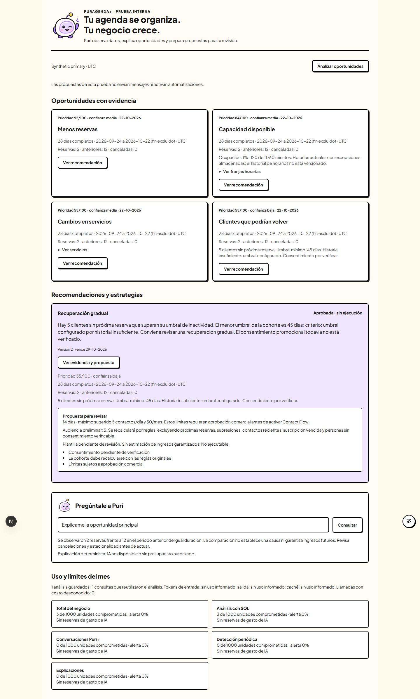

# Iteración 6 — validación y entrega A–N

Fecha de entrega: 22 de octubre de 2026, America/Santiago. Implementación interna completada; lanzamiento y ejecución Contact Flow no autorizados ni activados.

## A. Git inicial y final

- Worktree exclusivo: `C:\Users\diego\.codex\worktrees\puragenda-next-audit\agenda`.
- Rama: `feature/puragenda-next`.
- HEAD inicial: `b6b7336ac71a0709f1d141b3502c64895243915b`, sin cambios pendientes al comenzar iteración 6.
- Base de iteración 5 conservada: `653d186`, `bf2f09a`, `edc5d27`, `42e3022`, `b6b7336`.
- Entrega: cinco commits de implementación/pruebas, más el commit documental que contiene este informe; ver sección M.
- `git diff --check` y revisión del estado final sin cambios pendientes tras el commit documental.
- No se escribieron archivos del checkout original de Desktop, ni se hizo reset, merge, rebase, push o deploy. Los cambios de Git son locales y descendientes de la base recibida.

Las ramas `feature/puri-assistant` y `feature/puragenda-chatgpt-mcp` se revisaron como referencias de orquestación/telemetría y conector; no se fusionaron. La base ya incluía las capacidades compartidas pertinentes. No se agregaron herramientas públicas MCP de crecimiento ni permisos de ejecución externos.

## B. Arquitectura implementada

Un solo Puri: `answerWithPuri` conserva su comportamiento estándar cuando no recibe la extensión opcional creada por servidor. La extensión usa el cliente OpenAI y Responses API existentes, respuesta estructurada, herramientas verificadas, límites de rondas y telemetría.

El motor comercial determinista y persistente vive en `src/server/puri/growth/`. Se exige entorno local desechable, Plus con pago confirmado y permisos efectivos antes de consultar agregados. Se revalida el scope completo para cada operación/herramienta. La pregunta libre se transforma en intenciones acotadas antes del modelo; no se reenvía como prompt original.

La arquitectura, reglas exactas, estados, restricciones de consulta y contratos están en [17 — Puri+ e inteligencia comercial](./17-puri-plus-inteligencia-comercial.md).

## C. SQL y señales disponibles

| Señal/capacidad | Evidencia comprobada |
|---|---|
| Clientes inactivos | Medianas personales/negocio, fallback configurable y exclusión de próxima reserva |
| Capacidad disponible | Horarios reales almacenados, descansos, overrides, bloqueos, unión de intervalos y agendas compartidas |
| Tendencia de demanda | Períodos civiles completos comparables, muestra mínima y caída porcentual |
| Desempeño de servicios | Conteos por servicio y variación, ranking acotado, cobro/nominal cuando hay permiso |
| Retención | Nuevos/recurrentes y retorno de clientes completados entre períodos dentro del alcance |
| Datos financieros | Cobro registrado conocido, nominal estimado y cobro desconocido separados |

Las consultas son parametrizadas, con snapshot y timeouts. Se conservan período, criterios, versión y hashes de fuentes/evidencia. Una cohorte no certifica consentimiento. No se seleccionan ni envían nombres, correos, teléfonos o notas de clientes; no se consulta `acceptsMarketing` para decidir consentimiento.

La capacidad no se inventa si faltan horarios o información externa/compartida. Las recurrencias se cuentan por reservas materializadas, sin volver a sumar el plan recurrente. Se prueban solapamientos históricos, sucursales y agenda Individual/Equipo. El análisis no libera retenciones ni altera disponibilidad.

La consulta financiera evita confundir precio actual con cobro histórico: ante pagos/cierres sin total histórico, el total cobrado queda `null`, con subtotal conocido y cantidad de importes desconocidos. Se verifican moneda POS, sobrepago limitado, abonos, Gift Cards y cancelaciones.

## D. Capacidades nuevas del mismo Puri

Niveles `PURI_STANDARD`, `PURI_PLUS` y `PURI_PLUS_PREPARE`. Cinco herramientas: `get_growth_signals`, `get_service_performance`, `get_inactive_client_cohort`, `get_growth_recommendations` y `prepare_contact_flow`.

Cada una declara lectura/preparación, permisos, consumo y resultados. Las financieras/de clientes se excluyen si el rol no tiene permiso. Preparar requiere intención explícita y autorización. No existe una herramienta para aprobar, enviar, cambiar precios, descontar o modificar suscripciones. Inyecciones que intentan usar herramientas estándar con datos personales o acciones inventadas se bloquean antes del ejecutor.

La explicación determinista cubre las dimensiones comerciales sin IA. El proveedor sólo mejora explicación cuando flag, tarifa y presupuesto lo permiten. Respuestas inválidas, falta de uso/tarifa, error o agotamiento conservan el fallback y el registro de consumo/estado desconocido correspondiente.

## E. Motor proactivo

`runGrowthScheduler` está preparado como servicio local, sin cron productivo ni cambio de `vercel.json`. Políticas opt-in por negocio, alcance por sucursal, frecuencia configurable, cursor de continuación, máximo de candidatos, deadline y presupuesto SQL global/categoría.

Hay leases con fencing token, caché por hora, revisión proactiva durable incluso al reutilizar análisis interactivo, recuperación acotada y supresión de evidencia repetida. Un rechazo de inactividad no reaparece por un cambio de cobro ajeno a la cohorte. Los fallos no dejan señales parciales confirmadas.

La detección proactiva no llama a OpenAI. Las recomendaciones y explicaciones IA son una fase separada. Los límites de wall-clock entre trabajos y de cada consulta están documentados; no se declara un worker productivo ya desplegado.

## F. Modelos y migración

Migración aditiva `20261022210000_puri_plus_growth`: siete tablas nuevas (`PuriGrowthPolicy`, `Run`, `Signal`, `Recommendation`, `Audit`, `PuriBudgetBucket`, `PuriUsageReservation`) y tier en `PuriRequest`.

Incluye claves de idempotencia, FKs compuestos tenant/scope, índices de estado/lease/expiry, checks de estados/importes/no ejecución y trigger de inmutabilidad de contenido/evidencia/aprobación. Las siete tablas tienen RLS y grants públicos revocados. La verificación canónica comprueba también esta seguridad.

Bootstrap y actualización legacy pasaron, incluyendo reejecución, drift, preservación de datos/historial y rechazo de políticas manuales no revisadas. No se modificó ningún archivo de migración anterior. Expiry y purga explícita local tienen política validada y lotes limitados; la auditoría de aprobaciones se conserva durante su retención mayor. La retención contable productiva sigue pendiente.

## G. Recomendaciones y aprobaciones

Flujo comprobado en base real:

1. Plus pagado accede a su alcance autorizado.
2. SQL detecta una cohorte preliminar y otras oportunidades con evidencia reproducible.
3. La señal y el borrador se guardan sin duplicarse bajo concurrencia.
4. El propietario visualiza la evidencia y prepara la estrategia.
5. La preparación congela una nueva versión/hash.
6. La revisión vuelve a consultar evidencia sin confiar en caché.
7. El propietario marca el checkbox y aprueba explícitamente esa versión.
8. La aprobación y su identidad/hash quedan auditados una sola vez.
9. La propuesta conserva `executable=false` y motor no implementado.

Expiración, cambio de evidencia, hash/versión erróneos y estados incompatibles bloquean la aprobación. Cinco aprobaciones concurrentes producen un único evento de aprobación. Un modelo no puede aprobar su propia propuesta.

La verificación es puntual y no congela la agenda operativa. El contrato de entrega futura vuelve a comprobar estado, evidencia y vigencia y enumera requisitos pendientes. La aprobación no crea destinatarios, enrollment, outbox, campañas ni mensajes.

## H. Presupuesto y protección de consumo

Reservas atómicas mensuales global/negocio/categoría con lock corto. Pruebas PostgreSQL demuestran límites simultáneos en una categoría, entre categorías y entre negocios. No se sobreasignan unidades mediante concurrencia. Hay idempotencia, liquidación, alertas al 50/80/100%, intentos denegados y recuperación de reservas abandonadas.

El cálculo monetario reutiliza tarifas del modelo exacto configuradas por servidor. Sin precio, no se llama al proveedor. Uso no informado o salida ambigua no se registra como costo cero: se retiene el compromiso máximo y se bloquea nuevo gasto IA del negocio hasta conciliación. El global mantiene esa reserva sin bloquear automáticamente a otros negocios con presupuesto y tarifa conocida. No hay reintentos de red automáticos tras incertidumbre.

Las tarifas y límites de fixtures son sintéticos. No se aprobó una asignación comercial para $22.990 CLP ni se publicó un margen calculado con inputs inventados. La categoría estándar queda preparada, sin cambiar el comportamiento productivo de Puri estándar.

## I. Experiencia interna verificada

Página `/internal/puri-plus`, API privada del laboratorio, selector de sucursal autorizada, identidad Puri existente, señales con prioridad/confianza/fecha, evidencia, franjas/servicios desplegables, propuestas, revisión, aprobación/rechazo y uso/presupuesto.

Chrome/Playwright completó el flujo con PostgreSQL sintético, sin claves de proveedor ni llamadas pagadas. Tamaños 1440×1050 y 390×844: sin desbordamiento horizontal, botones con nombre accesible, metadatos noindex y cero errores de página. La comprobación de accesibilidad es funcional/básica, no una certificación WCAG completa.

Se verificó el checkbox inicialmente deshabilitando aprobación, la aprobación auditada/no ejecutable, fallback SQL del chat y respuesta 403 a estándar sin crear runs. El runner cierra navegador/servidor y limpia únicamente sus negocios sintéticos; conserva la base y evidencia de QA.

Artefactos versionados:

- [Resultado browser JSON](./evidence/iteration-6-browser-result.json): nueve resultados funcionales identificados, sin IDs personales ni cookies.
- [Captura escritorio](./evidence/iteration-6-desktop.png).
- [Captura móvil](./evidence/iteration-6-mobile.png).

## J. Resultados exactos de validación

| Verificación | Resultado final |
|---|---|
| Suite completa `npm run test:commercial:postgres -- --all` | **1.640 aprobadas, 131 omitidas, 0 fallidas**; 224 archivos aprobados, 6 omitidos; 54,75 s |
| PostgreSQL comercial | **127 aprobadas**: 79 anteriores + 48 nuevas Puri+; cuatro archivos, con PostgreSQL 17.2 real |
| Nuevas pruebas | **97**: 49 unitarias/frontera/orquestación + 48 PostgreSQL; incluidas en la suite completa |
| Foco Puri `vitest run puri-growth puri.` | **100 aprobadas, 48 omitidas**, 15 archivos aprobados/1 omitido; el omitido es PostgreSQL sin URL en esa ejecución focalizada y se ejecutó en la suite real |
| TypeScript `npm run typecheck` | Correcto: `next typegen` y `tsc --noEmit`, 0 errores |
| ESLint `npm run lint` | 0 errores, **32 warnings legacy**, ninguno nuevo |
| Prisma validate | Esquema válido |
| Prisma generate | Cliente generado con Prisma **7.10.0** |
| Migraciones reproducibles | Bootstrap, legacy upgrade, preservación de datos/historia, schema match y redeploy sin cambios: correctos |
| Build de producción aislado | Next.js **16.3.8**, compilación/TypeScript/prerender final correctos; sin credenciales y flags comerciales/Puri+ cerrados |
| Navegador real | Flujo completo y nueve comprobaciones funcionales identificadas: correctos; 0 errores de página, 0 llamadas reales a proveedores |
| `git diff --check` | Correcto |
| Credenciales | Escaneo de contenido de archivos de texto modificados: 0 coincidencias de patrones de claves de proveedores; revisión de fixtures, env y artefactos |
| Flags y regresión estándar | Defaults cerrados; rechazo explícito en producción; ruta/contexto/prompt/tools/UI estándar sin diferencias frente a la base |

La línea base de 1.543 aprobadas/131 omitidas se conserva y aumenta en 97. No se eliminaron ni omitieron pruebas anteriores para lograr este resultado.

El fallo de desarrollo final fue una fixture nueva incompleta de evidencia (faltaba período para un fallback); se corrigió la fixture y se volvió a ejecutar la suite completa con resultado anterior. Los primeros fallos nuevos de preparación se debieron a checks de la base, bloqueo de reservas solapadas y deserialización del retorno `void` del advisory lock; se corrigieron sin desactivar los guards operativos. Las 79 pruebas PostgreSQL anteriores pasaron durante esas correcciones. No queda un fallo conocido oculto.

Logs locales, no versionados, en `scratch/`:

| Evidencia | Archivo/base |
|---|---|
| Suite completa aceptada | `iteration-6-full-accepted.log`; DB `puragenda_commercial_test_c65202299ef5` |
| PostgreSQL focalizado | `iteration-6-postgres-verified.log`; DB `puragenda_commercial_test_ecdcfd742572` |
| Foco Puri | `iteration-6-puri-verified.log` |
| Tipos y lint | `iteration-6-typecheck-accepted.log`, `iteration-6-eslint-accepted.log` |
| Prisma | `iteration-6-prisma-validate.log`, `iteration-6-prisma-generate.log` |
| Producción aislada | `iteration-6-build-accepted.log` |
| Bootstrap/legacy | `iteration-6-migrations.log`; bases `puragenda_commercial_bootstrap_test_09b2d92f6405` y `puragenda_commercial_legacy_test_09b2d92f6405` |
| Navegador | `iteration-6-browser-complete.log`, `puri-plus-qa/next-dev.log`; DB `puragenda_commercial_test_19b3d24e5c10` |

Los stderr de fixtures legacy incluyen rechazos de firma, claves ausentes y envíos simulados deliberadamente. No indican llamadas reales o fallos de la suite. Se observa además la advertencia de compatibilidad futura Vite/config nativo y una de `pg` sobre consultas encoladas; no se ocultaron ni se actualizó el árbol de dependencias como parte de esta fase.

## K. Estándar frente a Plus

| Caso | Comportamiento comprobado |
|---|---|
| Puri estándar habitual | Misma ruta, herramientas, cliente, prompt, contexto, rate limit y respuestas operativas |
| Estándar intentando Plus | API 403, sin ejecutar análisis ni crear run |
| Plus con pago pendiente/trial/expirado | Rechazo antes de agregados comerciales |
| Plus sin finanzas | No se consulta/devuelve dinero ni se expone herramienta financiera |
| Plus con agenda/sucursal limitada | Evidencia propia; acceso a otra sucursal o negocio rechazado |
| Plus válido | SQL/señales/recomendaciones según permisos; IA opcional con precio/presupuesto |
| Plus sin presupuesto o IA disponible | Datos persistidos/fallback determinista cuando existen; ninguna llamada IA no presupuestada |
| Propietario/marketing autorizado | Puede preparar, revisar y aprobar; nunca ejecutar Contact Flow |
| Producción | Nuevas rutas/servicios cerrados incluso con los flags locales abiertos |

El único cambio compartido de orquestación es la extensión opcional; el default estándar pasó sus regresiones. El campo de tier agrega clasificación a la telemetría sin cambiar acciones productivas.

## L. Riesgos y bloqueos pendientes

1. Contact Flow ejecutor, consentimiento por finalidad/supresiones, cuotas reales de envío, plantillas, webhooks y atribución no están implementados.
2. Presupuestos comerciales y tarifas verificadas del modelo exacto, evaluación de calidad real y conciliación de costos desconocidos requieren aprobación/configuración. Las pruebas ordinarias no consumieron OpenAI real.
3. No hay versiones históricas de todos los horarios ni cache de free/busy externo. Se limita la confianza y se suprime capacidad accionable incierta; hace falta resolverlo para una cobertura productiva mayor.
4. Rankings, tamaños de dataset, deadlines y lotes están acotados; faltan pruebas de carga con volúmenes representativos y política para negocios/catálogos mayores. El laboratorio usa ventanas e intenciones acotadas.
5. La verificación de evidencia es puntual y conservadora. El siguiente día puede cambiar la ventana; el futuro ejecutor debe revalidar y definir una política de vigencia operativa, sin reutilizar una aprobación obsoleta.
6. Deben aprobarse trial, retención productiva de contabilidad/auditoría y políticas legales antes del lanzamiento único.
7. Persisten las decisiones de impuestos, proveedores, migración/cutover y pruebas reales sandbox de billing de las iteraciones anteriores.

No existe bloqueo para revisar o repetir esta implementación local. Estos puntos bloquean activación productiva y ejecución externa, no se presentan como funcionalidades terminadas.

## M. Commits locales

| Commit | Responsabilidad |
|---|---|
| `0c1e596` | Modelos, migración aditiva y verificación de seguridad |
| `f8b4d6f` | Motor SQL/capacidad, acceso, análisis durable y reservas de presupuesto |
| `18652a1` | Extensión del orquestador, herramientas, propuestas, decisiones, proactividad y retención |
| `cd5834e` | Experiencia interna, API y flags cerrados |
| `714869c` | Pruebas reales PostgreSQL y runner de navegador aislado |
| `HEAD` documental de entrega | Este informe, arquitectura, trazabilidad y artefactos de QA; mensaje `docs(puri): record iteration 6 architecture and verified delivery` |

La respuesta de entrega registra el hash final. `git log -6 --oneline` resuelve el commit documental y los cinco anteriores sin reescribir historia. El worktree se comprueba limpio al cerrar; no hubo push.

## N. Próxima fase: Contact Flow

Comenzar con consentimiento verificable por finalidad y ledger de supresión/bajas. Después implementar un DSL de campañas acotado, enrollment y outbox/worker idempotente, cuotas atómicas diarias/mensuales/globales y kill switch. La entrada será una propuesta aprobada con hash/versión, revalidada contra entitlement, permisos, evidencia actual y restricciones de cada destinatario.

Implementar entregas, fallos/reintentos y webhooks con pruebas contractuales antes de conectar un proveedor real. La atribución necesita su propio mecanismo verificable de eventos/reservas; hasta entonces no se medirá recuperación ni ingreso atribuido. Mantener Contact Flow y Puri+ ocultos hasta aprobar políticas y el lanzamiento conjunto de Puragenda Next.
